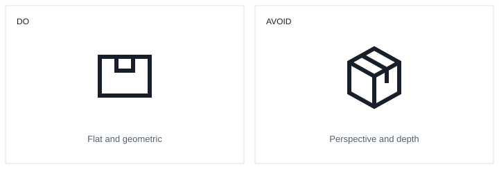
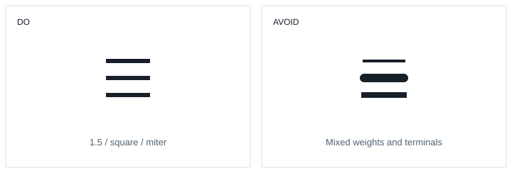
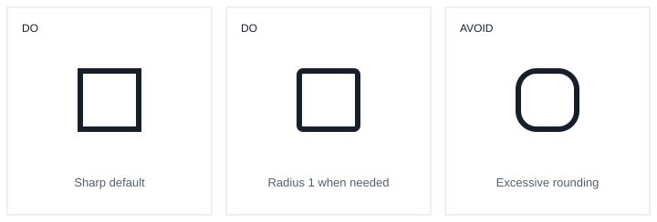
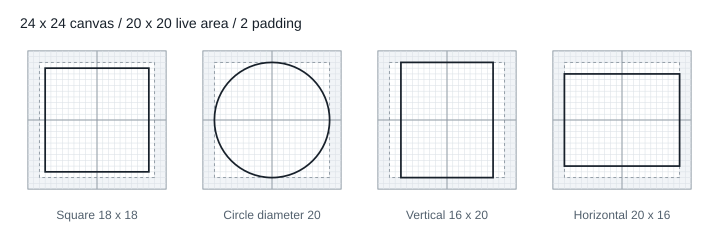
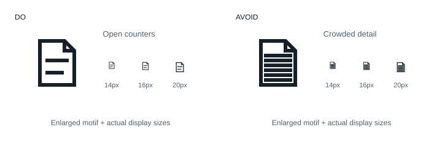
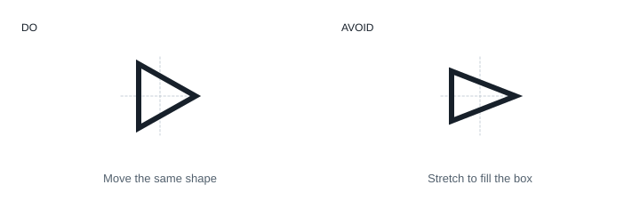
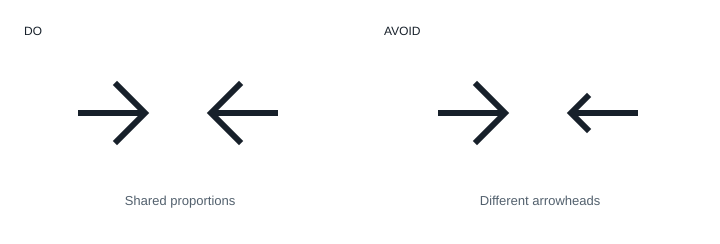
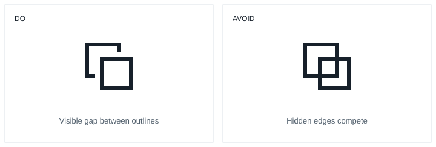
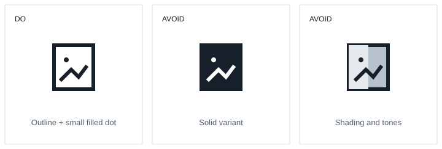

# Icon design principles

Idenflu 시스템 아이콘은 단색 outline 스타일로 의미를 명료하게 표현한다. 단순한 기하 형태, 일정한 선, 균형 잡힌 공간을 사용하며, 하나의 공통 도형이 14px 이상의 표시 크기에서 읽혀야 한다.

## 의미와 단순성

### 하나의 핵심 모티프

- 익숙한 사물과 기호에서 대상·동작을 식별하는 특징만 남긴다. 장식이나 세부 묘사가 없어도 핵심 의미가 유지되어야 한다.
- 브랜드 고유의 비유도 사용할 수 있다. 다만 같은 의미를 나타내는 모티프는 일관되게 사용하고, 낯선 비유를 설명하기 위해 도형을 계속 덧붙이지 않는다.
- 하나의 아이콘에 여러 독립된 의미를 나열하지 않는다. 보조 요소는 기본 모티프와의 관계가 분명하고 의미 구분에 필요한 경우에만 사용한다.

권장: 봉투의 외곽과 접힌 선으로 메시지를 표현한다. 지양: 우표·장식선·배지를 더해 작은 크기에서 핵심 모티프와 경쟁하게 만든다.

## 기하학적 형태

### 직선과 곡선

- 원·사각형·직선 등 명확한 기하 형태로 구성한다. 손그림 같은 불규칙한 윤곽이나 의미 없이 흔들리는 곡선을 사용하지 않는다.
- 수평·수직·45° 대각선을 기본으로 한다. 모티프의 특징을 표현하는 데 필요한 다른 각도는 허용한다.
- 곡선은 원형 물체나 손잡이처럼 의미를 구성하는 부분에 사용한다. 대칭 모티프는 중심축과 양쪽 비례를 유지하되, 비대칭 대상에 대칭을 강제하지 않는다.

### 평면적 표현

- 정면의 평면적 형태를 기본으로 한다. 동작이나 사물의 식별에 필요한 기울기는 허용한다.
- 원근, 입체 돌출, 그림자, 하이라이트와 명암으로 부피를 표현하지 않는다.

권장: 평면의 외곽과 필요한 구분선만 남긴다. 지양: 같은 대상을 여러 면과 깊이로 묘사한다.

## 선과 모서리

### 선 두께와 끝 처리

- 24×24 좌표계에서 선 두께는 **1.5**로 통일한다. 외곽선·내부선·직선·곡선에 같은 두께를 적용한다.
- 선 끝은 각진 square, 선의 연결은 각진 miter를 사용한다. 같은 아이콘이나 계열 안에서 둥근 끝·둥근 연결을 섞지 않는다.
- 작은 크기의 가독성은 간격과 형태의 단순화로 확보한다. 일부 선만 두껍게 하거나 가늘게 만들어 해결하지 않는다.

### 접합부의 외곽

- 선이 만나는 지점에는 외곽을 벗어나는 작은 돌기나 불필요한 두께 증가가 없어야 한다. 다른 선에 연결되는 끝과 외부에 드러나는 끝을 구분한다.
- 외부에 드러나는 끝은 square를 유지한다. 접합부에서는 연결되는 선의 길이를 보정하거나, 접합용 선에만 확장 없는 평평한 끝인 butt를 사용해 끝이 다른 선 밖으로 튀어나오지 않게 한다.
- 모서리의 miter와 접합부의 선 끝 보정은 구분한다. 돌출을 감추려고 모든 모서리를 둥글게 하거나 화살촉을 일괄 잘라내지 않는다.

권장: 동일한 두께와 각진 외부 선 끝을 유지하고, 접합부는 매끄럽게 연결한다. 지양: 두께와 끝 처리를 무관하게 혼용한다. 접합용 butt 처리는 외곽 돌출을 없애기 위한 예외다.

### 모서리 반경

- 기본 도형의 모서리는 각지게 유지한다. 둥근 외곽 모서리가 필요한 도형에만 공통 반경 **1**을 적용한다. 수치는 24×24 좌표계 기준이다.
- 공통 반경은 도형 자체의 곡률이다. 선 끝을 round로 바꾸거나 모든 연결부를 둥글게 만드는 규칙이 아니다.
- 같은 계열의 대응하는 모서리는 동일한 반경을 사용한다. 모서리를 둥글게 하기 위해 좁은 내부 공간을 메우거나 모든 안쪽 모서리까지 둥글게 만들지 않는다.
- 원·타원·고유한 곡선은 모티프의 비례로 결정하며, 공통 모서리 반경 1로 대체하지 않는다.

권장: 각진 기본형을 유지하거나 필요한 외곽만 반경 1로 통일한다. 지양: 외곽 전체를 크게 둥글려 다른 계열처럼 보이게 한다.

## Grid and keylines

### 캔버스와 여백

- 공통 캔버스는 **24×24**, 중심은 **(12, 12)**다. 그리드는 형태와 위치의 기준이며 모든 좌표를 정수로 제한하지 않는다.
- 기본 도형 영역은 **20×20**, 사방 여백은 **2**다. 이는 [Material의 Layout 원칙](https://m2.material.io/design/iconography/system-icons.html#grid-and-keyline-shapes)을 따른다.
- 추가적인 시각적 무게가 필요한 경우 도형이 여백을 일부 사용할 수 있다. 여백은 일반적인 도형 배치 영역으로 쓰지 않으며, 선과 각진 모서리를 포함한 전체 외곽은 24×24 캔버스 밖으로 나가지 않는다.

### 형태별 키라인

- 정사각형은 **18×18**, 원은 **지름 20**, 세로형은 **16×20**, 가로형은 **20×16**을 기준으로 한다. 각 키라인은 캔버스 중심에 배치한다.
- 키라인 치수는 선 두께를 포함한 시각적 외곽의 비교 기준이다. 선 중심을 키라인 위에 그대로 올려 실제 외곽이 더 커지게 만들지 않는다.
- 형태에 맞는 키라인으로 비례를 잡는다. 정사각형과 원을 똑같은 외접 크기에 억지로 맞추거나, 모든 모티프를 20×20에 가득 채우지 않는다.

도해의 도형은 키라인 경계를 나타낸다. 실제 아이콘의 선 중심선과 구분한다.

## 공간과 가독성

### 내부 빈 공간

- 내부 빈 공간도 도형의 일부로 취급한다. 선이 둘러싼 공간, 평행선 사이, 도형이 만나는 지점의 밀도를 같은 계열 안에서 맞춘다.
- **14px에서 분리되어야 하는 선은 붙어 보이지 않아야 한다.** 작게 표시했을 때 사라지는 틈이나 검게 뭉치는 교차점은 간격을 넓히거나 세부 요소를 줄인다.
- 최소 내부 간격의 공통 수치는 아직 확정하지 않는다. 아래 비교는 간격과 밀도의 원칙을 설명하며, 대표 아이콘 비교 전까지 특정 간격을 시스템 전체의 최소값으로 간주하지 않는다.

### 작은 크기에서의 단순화

- 14px 이상에서 동일한 도형을 사용한다. 크기별로 세부 묘사를 추가하거나 선 두께를 별도로 바꾸지 않는다.
- 가장 작은 크기에서도 핵심 모티프의 외곽과 특징이 남아야 한다. 확대 상태에서만 보이는 묘사보다 전체 실루엣과 열린 내부 공간을 우선한다.

권장: 14px에서도 외곽과 내부 선이 구분되는 형태. 지양: 작은 크기에서 촘촘한 선과 장식이 하나의 덩어리처럼 보이는 형태. 크기별 표시는 도해의 원본 배율을 기준으로 한다.

## 시각적 균형

### 크기와 중심

- 기하학적 중심과 시각적 중심은 다를 수 있다. 한쪽으로 무게가 쏠리는 삼각형이나 비대칭 형태는 실제로 가운데 놓여 보이도록 위치를 보정한다.
- 같은 계열의 아이콘을 나란히 보았을 때 크기와 무게가 비슷해야 한다. 외접 크기를 기계적으로 같게 만드는 것보다 균형 잡힌 인상을 우선한다.
- 보정은 위치·비례·내부 간격의 최소 조정으로 한다. 기하 형태를 찌그러뜨리거나 공통 선 두께를 바꾸지 않는다.

권장: 형태를 유지하며 시각적 중심을 맞춘다. 지양: 영역을 채우려고 가로세로 비례를 바꾼다. 점선은 중심축을 나타낸다.

### 방향과 의미 변형

- 방향만 다른 아이콘은 같은 기본 도형과 비례를 공유한다. 회전·반사 후에도 시각적 무게와 중심을 유지한다.
- 의미가 달라질 때만 도형을 변경한다. 기본 모티프를 유지하고 의미 구분에 필요한 부분만 추가하거나 바꾼다.

권장: 방향이 달라도 같은 계열로 읽히는 비례. 지양: 방향마다 화살촉의 폭과 길이가 달라지는 형태.

## 채움과 색상

### 부분 채움과 겹침

- 전체 스타일은 outline으로 유지한다. 점과 작은 식별 요소에만 부분 채움을 허용하고, 아이콘 전체를 채움형으로 바꾸지 않는다.
- 도형이 겹치는 표현은 의미 전달에 필요한 경우 허용한다. 앞쪽 도형과 겹치는 뒤쪽 선을 끊고, 끊어진 선 끝과 앞쪽 외곽 사이에 눈에 보이는 빈 여백을 둔다. 선이 맞닿아 하나의 도형처럼 보이거나 겹친 부분이 두꺼워 보이지 않아야 한다.
- 이 여백은 경로 중심 사이가 아니라 실제 선 외곽 사이를 기준으로 한다. 각진 선 끝이 확장되는 길이까지 고려해 14px에서도 끊어짐이 읽히게 한다. 공통 간격 수치는 대표 아이콘 비교 후 확정한다.
- 작은 채움 요소는 외곽선보다 과도하게 눈에 띄거나 내부 공간을 막지 않아야 한다.

권장: 뒤쪽 선과 앞쪽 외곽 사이에 빈 여백을 남겨 앞뒤 관계를 구분한다. 지양: 가려진 선까지 모두 보여 교차점과 내부 공간을 복잡하게 만든다. 도해의 간격은 표현 예시이며 공통 최소값이 아니다.

### 단색 표현

- 하나의 아이콘에는 한 가지 색만 사용한다. 부분 채움도 선과 같은 색을 사용한다.
- 그라데이션, 다중 색상, 반투명 면, 그림자와 명암 효과를 사용하지 않는다.
- 선택·활성 상태는 색상으로 구분하며 outline 도형을 유지한다. 의미가 같다면 상태별 채움형을 따로 만들지 않는다.

권장: 단색 외곽선과 필요한 작은 채움. 지양: 전체 채움이나 명암으로 다른 스타일을 만드는 표현.

## 관련 문서

- [아이콘 작업 규칙](../../../packages/icons/AGENTS.md): 생성·등록·검증 절차
- [아이콘 가이드](icons.mdx): 사용법과 패키지 구조
- [Material 2 System icons](https://m2.material.io/design/iconography/system-icons.html): 그리드·키라인·형태 원칙 참고
